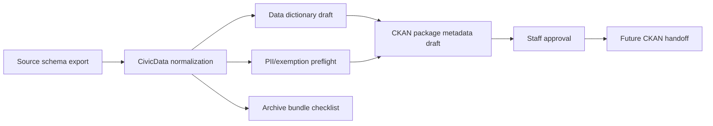

## Windows 1.9.3.2 current release

Townlight for Windows 1.9.3.2 is the current signed public beta. See the [release notes](https://github.com/townlight/townlight/releases/tag/townlight-windows-v1.9.3.2) and [acceptance record](https://github.com/townlight/townlight/releases/download/townlight-windows-v1.9.3.2/ACCEPTANCE-Windows-1.9.3.2.md).

Townlight Windows 1.9.3.2 is a signed Suite package; Data, Budget, and Grants were first bundled in Windows 1.9.3.1 and remain in the current signed 1.9.3.2 Windows beta.

# Townlight Data User Manual

## Non-technical staff guide

Townlight Data helps a city prepare datasets before they are published to an open-data portal. It is a preparation and review tool with optional saved CKAN package/publication-plan workpapers, not an automatic publishing robot.

### What staff can do today

1. Review source fields and normalize them into clear open-data names.
2. Draft a data dictionary so residents understand what each field means.
3. Prepare CKAN-style package metadata for a future open-data portal handoff.
4. Run a deterministic preflight for PII or exempt-record field names.
5. Create an archive bundle checklist tied to records-retention schedules.
6. Draft a publication checklist for recurring datasets.
7. Retrieve saved CKAN package and publication-plan workpapers when IT enables persistence and retrieval auth.

### Required human review

Every dataset still needs staff approval before publication. Staff must confirm the source-system owner, redaction/exemption status, open-data license, retention schedule, and publication target.

### What v0.2.0 does not do

Townlight Data does not publish directly to CKAN, does not host dashboards, does not store a data warehouse, does not make legal exemption decisions, and does not redact records automatically.

## IT and technical guide

### Runtime

Install with `python -m pip install -e ".[dev]"` and run with `python -m uvicorn townlight_data.main:app --host 127.0.0.1 --port 8137`.

Set `CIVICDATA_PUBLICATION_DB_URL` to enable SQLAlchemy-backed CKAN package draft and publication-plan records. Set `CIVICDATA_AUTH_TOKEN_ROLES` to a JSON token-to-role map before exposing persisted retrieval. Leave the database variable unset for deterministic stateless operation.

### Architecture

### Endpoints

The public endpoints are listed in `README.md`. All v0.2.0 endpoints are deterministic and local. They do not perform live connector calls or publish data to external services. Retrieval endpoints require both `CIVICDATA_PUBLICATION_DB_URL` and `CIVICDATA_AUTH_TOKEN_ROLES`.

### Dependency contract

Townlight Data depends on `townlight-core==1.3.0.dev2`. Townlight Core must not import Townlight Data Bridge.

### Verification

Run `bash scripts/verify-release.sh` before release. The script checks docs, tests, Ruff, build artifacts, and package metadata.

## Windows staff workflow

In Townlight Data 0.2.0, included in Townlight Windows beta 1.9.3.2, existing Contracts grants let staff select signed agreements and preview only contract ID, title, vendor, start/expiration. An admin explicitly confirms the actual SHA-256 preview before an unattended queue sends to the configured resident Portal. Status states cover selection, hash confirmation, queueing, acknowledgement, correction, and withdrawal. No public link appears until the receiving portal acknowledges. Public outputs include CSV, JSON, and dictionary. Corrections proceed through a new review; withdrawal removes anonymous downloads when delivered. Legacy standalone workpaper APIs remain separate.
